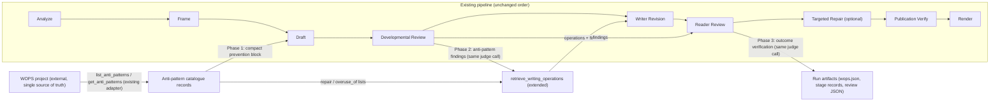

# Design

## The seam

The integration touches four existing seams. No new stage, executor, or LLM call is created.

## Current-state facts the implementation depends on

1. **WOPS adapter** (`digest_system/integrations/wops.py`): `WopsAdapter` already exposes `list_anti_patterns()` (tab-separated `id<TAB>summary` lines from the `antipatterns` CLI command) and `get_anti_patterns(ids)` (full JSON records from `show-antipattern <id> --json`). Both degrade to `{"ok": False, "error": ...}` without raising. The adapter is created once per run in `orchestrator.py` (`create_wops_adapter`) and passed to `execute_stage`. Verified against the real project (v0.4.0, 13 anti-patterns): `show-antipattern` returns `id, name, summary, why_it_matters, detection[], false_positives[], repair[], overuse_of[], problem_types[], scopes[], activities[], examples[], provenance, status, version`.
2. **Retrieval** (`retrieve_writing_operations` in `digest_system/editorial/executor.py`): one search per review issue (sorted by `SEVERITY_RANK`), merged into a pool keyed by operation id, capped at `limit` (default 5), then `get_writing_operations` fetches full records. The record (`wops.json`) keeps `adapter/available/reason/queries/candidates/selected/operations/warnings/limit`. Writer Revision and Targeted Repair read this artifact via `ctx.artifact_block("developmental-review", "writing_operations", "wops.json")`.
3. **Developmental review** (`evaluation/semantic/developmental.py`): one judge call, Pydantic schema `DevelopmentalReview` (fields: `issues`, `frame_obligations_missed`, `revision_priorities`, `dimensions`, `validation_notes` — a test asserts this exact field set and that no prose field exists). The prompt is rendered from `prompts/evaluation/developmental.j2` with the discipline from `prompts/evaluation/shared/developmental_discipline.j2`. The canonical problem-type vocabulary is loaded from WOPS `taxonomy/problem-types.yaml` (`evaluation/adapters/taxonomy.py::load_problem_types`) with a builtin fallback; the source is stamped on the artifact.
4. **Reader review** (`evaluation/semantic/metric.py::evaluate_reader_quality`): one absolute judge call, schema `ReaderQualityEvaluation` (`prompts/evaluation/absolute.j2`). The executor (`executor.py::_run_evaluation_stage`) flattens the result and derives `retry_instructions` for the optional Targeted Repair (`should_run_optional_stage`).
5. **Prompt composition**: `prompts/compose.py::BLOCK_TAGS` is the fixed vocabulary of user-message data blocks; `stages.py` declares which blocks each stage prints; `convention.py::SHARED_CONTRACTS_BY_STAGE` selects shared instruction files. The behavioral gate (`scripts/prompt_migration_gate.py` + `tests/fixtures/prompt_migration/behavioral-gate.json`) compares complete ordered candidate messages against the frozen baseline `tests/fixtures/prompt_migration/prompt-baseline.json` and fails on any unclassified difference or candidate-fingerprint mismatch.
6. **Offline fixtures**: `prompts/offline.py` holds `SYNTHETIC_WOPS` (a synthetic retrieval record) and seeds artifacts for inspection/baseline; `stage_extra_blocks(stage, context)` is the shared seam for executor-derived blocks (currently empty).
7. **Versioning**: `evaluation/version.py` stamps `DEVELOPMENTAL_REVIEW_ID`/`DEVELOPMENTAL_STEPS_VERSION`/`DEVELOPMENTAL_SCHEMA_VERSION` and `EVALUATION_ID`/`EVALUATION_STEPS_VERSION`/`SCHEMA_VERSION` onto every record. `comparable()` refuses cross-version semantic deltas.
8. **Degradation invariant**: a missing WOPS root, interpreter, or failed CLI call is recorded and the pipeline continues. Tests (`test_pipeline_execution.py::MockWops`, `test_integrations.py`) already exercise the unavailable path.

## Design decisions

### D1 — Prevention block is derived at run time, bounded in code, and delivered as a data block

- New module `digest_system/editorial/anti_patterns.py` (single owner of the integration boundary):
  - `load_catalogue(wops) -> AntiPatternCatalogue` — calls `list_anti_patterns()`, then `get_anti_patterns()` for the ids it needs; keeps `available`, `version` (from `wops.version`), `reason`, and the fetched records. Degrades to an empty catalogue with a reason.
  - `prevention_block(catalogue, *, max_items, max_bytes) -> str | None` — renders the compact guidance: per anti-pattern `name — summary` plus its false-positive conditions, conditioned phrasing ("X is a defect when …; it is not a defect when …"). Deterministic order (catalogue order), hard cap on items and bytes enforced by truncation with a recorded note. Returns `None` when the catalogue is unavailable or empty.
- Delivery: a new `BLOCK_TAGS` entry `anti_pattern_prevention` printed by `prompts/stages/draft/user.j2`; `stages.py` Draft `blocks` gains `ctx.anti_pattern_prevention_block()` (a `RunContext` method that calls into `anti_patterns.py` using the run's `wops` adapter — the orchestrator already holds it and passes it into the context scope). The block is inert data (wrapped like every other block), never rendered as a template.
- Bound: `MAX_PREVENTION_ITEMS = 13` (the whole catalogue fits, but the cap is enforced so a larger future catalogue cannot silently bloat Draft) and a byte cap (~2,500 chars) with truncation notes. The prompt manifest already records every block's bytes, so overhead is measurable via `scripts/measure_context.py` and `scripts/audit_prompts.py` without new tooling.
- WOPS unavailable → `prevention_block` returns `None` → the block is omitted (the join skips empty blocks) and the run record notes the omission. Drafting is never blocked.

### D2 — Detection extends the existing developmental schema and template

- `DevelopmentalReview` gains one field: `anti_pattern_findings: list[AntiPatternFinding]` (bounded, default empty). `AntiPatternFinding`: `anti_pattern_id` (canonical WOPS id), `section_id`, `severity` (existing `Severity` enum), `evidence` (one sentence locating the defect), `false_positive_considered: bool` (the judge records when it applied a false-positive condition and still reports, or why it did not report). A near-miss id is coerced against the fetched catalogue ids (same pattern as `coerce_problem_types`); unknown ids are recorded as notes, never silently dropped.
- The judge prompt gains the anti-pattern summaries + false-positive conditions (compact, from the catalogue) and one discipline rule: report a finding only when the detection signals match and no false-positive condition applies; judge whole-digest patterns (e.g. structural uniformity, formulaic closers) at document level with `section_id: null`.
- The executor passes the catalogue into the evaluation call via the existing `contracts`/request path: `EvaluationAdapter.evaluate_developmental_review` gains an optional `anti_patterns` payload entry; `evaluation/adapters/cli.py::_cmd_developmental` forwards it to `evaluate_developmental_review`, which renders it into the template. When WOPS is unavailable the payload is empty and the template section is omitted — the prompt reverts to today's shape.
- Version stamp: `DEVELOPMENTAL_STEPS_VERSION` → `v2` and `DEVELOPMENTAL_SCHEMA_VERSION` → `v2` (the response schema gains a field; the id stays `developmental_review_v1` because the metric's meaning is unchanged — the same convention `reader_quality_v4` used for additive steps changes is not applicable here, so the steps/schema versions move and the change is recorded rather than silent).
- The existing `test_developmental_review_never_carries_a_rewrite` field-set assertion is updated to include the new field (it stays prose-free).

### D3 — Repair selection extends the existing retrieval record

- `retrieve_writing_operations(review, wops)` gains the findings: for each anti-pattern finding (severity-ordered alongside the existing issues), fetch the anti-pattern record (already cached from Phase 1/2), and:
  - `repair` non-empty → the listed ids become candidates with `selection_reason: "repair for <anti-pattern-id>"`, fetched via `get_writing_operations` like any other candidate;
  - `repair` empty → no candidate; the finding's entry records `"repair": "deletion"` (the WOPS schema's documented meaning);
  - `overuse_of` ∩ selected ids → the selected entry gains `overuse_risk_for: [<anti-pattern-id>]`.
- Priority: the cap prefers critical/major findings and issues over minor ones (the pool is already severity-ordered; findings join the same ordering). Dropped candidates stay in `candidates` for audit.
- The record (`wops.json`) gains `anti_pattern_findings` (echo of the review's findings) and per-selection linkage (`selected_for`: issue problem types and/or anti-pattern ids). No new artifact: `wops.json` remains the single retrieval record, and `stages.py`'s `extra_artifacts=("wops.json",)` is unchanged.
- Unsuitable/missing repairs degrade exactly as today: fetch failures append to `warnings`, the revision proceeds on reviewer feedback alone.

### D4 — Writer Revision receives findings through the existing blocks

- The `writing_operations` block already carries `wops.json` verbatim into Writer Revision (and Targeted Repair). Because D3 records the findings and linkage inside `wops.json`, no new block and no template change are required for delivery.
- Instruction change (small, one owner): `editorial/stages/writer-revision.md` "What you receive" gains one bullet — anti-pattern diagnoses inside the writing-operations record, to be repaired like any diagnosed problem, applying false-positive conditions and never as a prose template. The style file `styles/synthesis-max/stages/writer-revision.md` already says "Retrieved writing operations are candidates for diagnosed problems, not a checklist" — unchanged.
- Every prompt change is classified in `behavioral-gate.json` (category `behavioral-change` with justification), and `approved_candidate_sha256` is updated deliberately after review.

### D5 — Verification extends the absolute reader schema

- `ReaderQualityEvaluation` gains `anti_pattern_outcomes: list[AntiPatternOutcome]` (bounded, default empty): `anti_pattern_id`, `status` (`resolved|partially_resolved|still_present`), `section_id`, `evidence`, and `new: bool` for occurrences the revision introduced. New findings caused by overusing an operation carry `overuse_of_operation: <operation-id>` when the judge can attribute it.
- The absolute prompt (`prompts/evaluation/absolute.j2`) gains the previously diagnosed findings (compact: id + summary + where it was found) and the response-schema addition. The judge is reminded of false-positive conditions. The comparison template (`comparison.j2`) is used by `compare-reader-quality` (replay/evaluation tooling), not by the production reader review; it gains the same optional section so the two templates do not drift.
- The executor's reader-review branch passes the developmental review's findings into the call (same `contracts`/request path as D2) and records `anti_pattern_outcomes` in the flattened result. `retry_instructions` derivation is unchanged: anti-pattern bookkeeping alone never creates a retry instruction; only an actionable major/critical issue does (`should_run_optional_stage` untouched).
- Version stamp: `EVALUATION_STEPS_VERSION` → `v4.1-anti-pattern-verification`, `SCHEMA_VERSION` → `v3` (additive field; `EVALUATION_ID` stays `reader_quality_v4` — the rubric's meaning is unchanged, so historical v4 scores remain comparable; the schema bump is recorded, and `comparable()` still matches on id).

### D6 — Observability rides existing artifacts

- `pipeline.json` runtime block: `wops` already records `describe()`; it gains `anti_patterns: {available, version, reason}`.
- `wops.json`: findings, selection linkage, overuse risks, deletion-repairs (D3).
- Stage records: `developmental-review` record gains `anti_pattern_findings` count summary in `notes`; `reader-review` record gains outcome counts in `notes`.
- Review JSON artifacts: findings (developmental) and outcomes (reader) are part of the persisted evaluation payloads.
- Effectiveness honesty: `wops.json` records what was *supplied*; the reader review's outcomes are the *verified* result. Nothing infers effectiveness from supply. No new artifact family, no new logging system.

### D7 — Degradation and generalization

- Every new code path takes the catalogue being empty/unavailable as a normal input and produces today's behavior plus a recorded note. The existing `MockWops` (unavailable) and `MockEvaluation` test doubles keep working; their mocks gain the new optional fields with defaults.
- No anti-pattern name, signal, or false-positive text is hard-coded in generic logic: all vocabulary flows from the fetched records. The generalization firewall test (`test_generalization_firewall.py`) pattern is extended if needed to assert no WOPS anti-pattern string is embedded in `digest_system/` or `evaluation/` source.

## Prompt/runtime sensitivity

- The behavioral gate is the acceptance gate for every prompt change: `python scripts/prompt_migration_gate.py --json` must exit 0 with `unclassified: 0` after the deliberate classifications and fingerprint update are recorded. The frozen baseline file itself is never regenerated.
- `prompts/offline.py` synthetic fixtures gain the new block/fields so inspection and baseline capture stay aligned (`stage_extra_blocks` is the seam if the executor must inject the block offline).
- The evaluation templates are shared by the editorial pipeline and the standalone evaluator; changes must keep the evaluator usable standalone (empty anti-pattern payload → unchanged prompt shape).

## Out of scope

- No change to Analyze or Frame responsibilities, artifacts, or prompts.
- No new editorial stage, no extra judge call, no new LLM call of any kind.
- No reintroduction of the Copy Edit stage or a comparison-mode production gate.
- No duplication of the WOPS catalogue, taxonomy, or detection logic in this repository; no edits to the WOPS project (a genuine integration blocker would be raised separately with evidence).
- No new artifact family or logging system; no change to delivery, replay, or historical-run behavior.
- No paid replay in Phases 1–2; the controlled replay comparison is Phase 3 work and requires explicit authorization.
