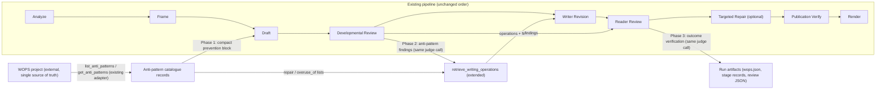

# Design

## The seam

The integration touches four existing seams. No new stage, executor, or LLM call is created.

## Current-state facts the implementation depends on

1. **WOPS adapter** (`digest_system/integrations/wops.py`): `WopsAdapter` already exposes `list_anti_patterns()` (tab-separated `id<TAB>summary` lines from the `antipatterns` CLI command) and `get_anti_patterns(ids)` (full JSON records from `show-antipattern <id> --json`). Both degrade to `{"ok": False, "error": ...}` without raising. The adapter is created once per run in `orchestrator.py` (`create_wops_adapter`) and passed to `execute_stage`. **Interface contract (verified live against the WOPS project, 2026-10-11):** these are *adapter-owned wrapper names*; the WOPS Python API's own methods are named differently (`WritingOperationsLibrary.list_antipatterns()`, `get_antipatterns(ids)`, `get_operations(ids)`, `search_operations(...)`, `from_project_root(...)`) and are NOT called directly — the adapter shells out to the WOPS CLI (`antipatterns`, `show-antipattern <id> --json`, `show <id> --json`, `search ... --json`), which is stable and emits the same record shape. WOPS loads anti-patterns from its canonical YAML (`antipatterns/*.yaml`), not SQLite, so `WOPS_ROOT` must be a local filesystem path to a WOPS checkout the subprocess can read (the current `.env` already points at the local Google Drive checkout path, which is a valid filesystem path). The catalogue is **dynamic**: 16 active entries at verification time (three added since planning: `em-dash-overuse`, `manufactured-balance`, `outline-in-place-of-explanation`); no count or id list is hardcoded, and `activities[]` (7 entries currently carry `drafting`), `detection[]`, `false_positives[]`, and `repair[]` are read from the fetched records.
2. **Retrieval** (`retrieve_writing_operations` in `digest_system/editorial/executor.py`): one search per review issue (sorted by `SEVERITY_RANK`), merged into a pool keyed by operation id, capped at `limit` (default 5), then `get_writing_operations` fetches full records. The record (`wops.json`) keeps `adapter/available/reason/queries/candidates/selected/operations/warnings/limit`. Writer Revision and Targeted Repair read this artifact via `ctx.artifact_block("developmental-review", "writing_operations", "wops.json")`.
3. **Developmental review** (`evaluation/semantic/developmental.py`): one judge call, Pydantic schema `DevelopmentalReview` (fields: `issues`, `frame_obligations_missed`, `revision_priorities`, `dimensions`, `validation_notes` — a test asserts this exact field set and that no prose field exists). The prompt is rendered from `prompts/evaluation/developmental.j2` with the discipline from `prompts/evaluation/shared/developmental_discipline.j2`. The canonical problem-type vocabulary is loaded from WOPS `taxonomy/problem-types.yaml` (`evaluation/adapters/taxonomy.py::load_problem_types`) with a builtin fallback; the source is stamped on the artifact.
4. **Reader review** (`evaluation/semantic/metric.py::evaluate_reader_quality`): one absolute judge call, schema `ReaderQualityEvaluation` (`prompts/evaluation/absolute.j2`). The executor (`executor.py::_run_evaluation_stage`) flattens the result and derives `retry_instructions` for the optional Targeted Repair (`should_run_optional_stage`).
5. **Prompt composition**: `prompts/compose.py::BLOCK_TAGS` is the fixed vocabulary of user-message data blocks; `stages.py` declares which blocks each stage prints; `convention.py::SHARED_CONTRACTS_BY_STAGE` selects shared instruction files. The behavioral gate (`scripts/prompt_migration_gate.py` + `tests/fixtures/prompt_migration/behavioral-gate.json`) compares complete ordered candidate messages against the frozen baseline `tests/fixtures/prompt_migration/prompt-baseline.json` and fails on any unclassified difference or candidate-fingerprint mismatch.
6. **Offline fixtures**: `prompts/offline.py` holds `SYNTHETIC_WOPS` (a synthetic retrieval record) and seeds artifacts for inspection/baseline; `stage_extra_blocks(stage, context)` is the shared seam for executor-derived blocks (currently empty).
7. **Versioning**: `evaluation/version.py` stamps `DEVELOPMENTAL_REVIEW_ID`/`DEVELOPMENTAL_STEPS_VERSION`/`DEVELOPMENTAL_SCHEMA_VERSION` and `EVALUATION_ID`/`EVALUATION_STEPS_VERSION`/`SCHEMA_VERSION` onto every record. `comparable()` refuses cross-version semantic deltas.
8. **Degradation invariant**: a missing WOPS root, interpreter, or failed CLI call is recorded and the pipeline continues. Tests (`test_pipeline_execution.py::MockWops`, `test_integrations.py`) already exercise the unavailable path.

## Design decisions

### D1 — Prevention block is derived at run time, selected by relevance, and delivered as a data block

- New module `digest_system/editorial/anti_patterns.py` (single owner of the integration boundary):
  - `load_catalogue(wops) -> AntiPatternCatalogue` — calls `list_anti_patterns()`, then `get_anti_patterns()` for the ids it needs; keeps `available`, `version` (from `wops.version`), `reason`, and the fetched records. Degrades to an empty catalogue with a reason.
  - `prevention_block(catalogue, *, max_items, max_bytes) -> tuple[str | None, dict]` — selects a small, relevant subset using WOPS record metadata (`activities[]`: entries whose activities include `drafting` are preferred; the rest follow catalogue order), then renders each selected entry **whole**: `name — summary` plus its false-positive conditions, conditioned phrasing ("X is a defect when …; it is not a defect when …"). Entries are never cut mid-sentence: when the byte budget is exhausted, the remaining entries are omitted whole and the omitted count is recorded in the returned metadata. Returns `(None, …)` when the catalogue is unavailable or empty.
- Delivery: a new `BLOCK_TAGS` entry `anti_pattern_prevention` printed by `prompts/stages/draft/user.j2`; `stages.py` Draft `blocks` gains `ctx.anti_pattern_prevention_block()` (a `RunContext` method that calls into `anti_patterns.py` using the run's `wops` adapter — the orchestrator already holds it and passes it into the context scope). The block is inert data (wrapped like every other block), never rendered as a template.
- Bound: `MAX_PREVENTION_ITEMS = 5` (a small, relevant subset — not the whole catalogue) and a configurable byte budget (default ~3,500 bytes, overridable via runtime configuration) with whole-entry omission and a recorded omitted count. Developmental Review still uses the full catalogue for detection (D2). The prompt manifest already records every block's bytes, so overhead is measurable via `scripts/measure_context.py` and `scripts/audit_prompts.py` without new tooling.
- **Fair rotation across runs (Phase 2 extension).** The Phase 1 selection is deterministic but static: with a stable catalogue it supplies the same subset every run, permanently excluding the rest. Phase 2 extends `prevention_block` with a history-aware ordering step — the cap and budget keep bounding prompt size, they never permanently exclude an eligible entry:
  - **Eligibility first.** `activities[]` stage applicability remains the primary filter; an inapplicable entry is never selected for rotation credit, and its omission is recorded as `inapplicable` (a third omission reason alongside `item_cap` and `budget`).
  - **Least-recently-supplied preference.** Among eligible entries, prefer those least recently supplied to Draft **for the same digest and style profile** (scoped by `pipeline.json`'s `digest_id` + `style_profile_id`, so unrelated digest configurations do not distort the history). Never-supplied entries — including new catalogue entries — sort before any supplied entry.
  - **History source: existing artifacts, no new store.** Each run's Draft attempt already persists `prompt-manifest.json` with the prevention block's `source.selected_ids` (Phase 1). The rotation reads prior runs' `pipeline.json` (for `digest_id`/`style_profile_id`) and their Draft `prompt-manifest.json` files under `.digest-runs/`, ordered by the run's `started_at`. No database, no new artifact family, no state subsystem.
  - **Deterministic tie-break.** Equal recency resolves by catalogue order (the adapter's id ordering). Same catalogue + same history → identical selection.
  - **Budget behavior.** An entry that does not fit whole is skipped and the **next** eligible entry is considered (selection continues rather than stopping); no entry is ever truncated. The metadata gains `omitted_by_inapplicable` alongside the existing `omitted_by_item_cap`/`omitted_by_budget`, plus per-entry `selection_reasons` and the `history_used` summary (which prior runs were consulted).
  - **Fallback.** Missing, corrupted, or unreadable history → all eligible entries treated as never supplied, catalogue order, fallback recorded, pipeline uninterrupted.
  - This is a coverage/fairness mechanism only: no predictive scoring, no occurrence likelihood, no classifier, no LLM call.
- WOPS unavailable → `prevention_block` returns `None` → the block is omitted (the join skips empty blocks) and the run record notes the omission. Drafting is never blocked.

### D2 — Detection extends the existing developmental schema and template

- `DevelopmentalReview` gains one field: `anti_pattern_findings: list[AntiPatternFinding]` (bounded, default empty). `AntiPatternFinding`: `finding_id` (stable identifier assigned at diagnosis, reused by later stages — see D6), `anti_pattern_id` (canonical WOPS id), `section_id`, `severity` (existing `Severity` enum), `evidence` (one sentence locating the defect), `false_positive_considered: bool` (the judge records when it applied a false-positive condition and still reports, or why it did not report). A near-miss id is coerced against the fetched catalogue ids (same pattern as `coerce_problem_types`); unknown ids are recorded as notes, never silently dropped.
- The judge prompt gains a **bounded projection of the detection payload**: per anti-pattern, its id, summary, `detection[]` signals, and `false_positives[]` conditions — the signals are what establish the evidence, so the summary alone is not sufficient. The payload is size-bounded in code (whole records in, whole records out; the least relevant entries dropped whole when the bound is exceeded). The payload record carries `included_ids` and `omitted_ids`, the review artifact records both, and an omitted anti-pattern is treated as **not evaluated** — never as absent or clean. One discipline rule is added: report a finding only when the detection signals match and no false-positive condition applies; judge whole-digest patterns (e.g. structural uniformity, formulaic closers) at document level with `section_id: null`.
- The executor passes the catalogue into the evaluation call via the existing `contracts`/request path: `EvaluationAdapter.evaluate_developmental_review` gains an optional `anti_patterns` payload entry; `evaluation/adapters/cli.py::_cmd_developmental` forwards it to `evaluate_developmental_review`, which renders it into the template. When WOPS is unavailable the payload is empty and the template section is omitted — the prompt reverts to today's shape.
- Version stamp: `DEVELOPMENTAL_STEPS_VERSION` → `v2` and `DEVELOPMENTAL_SCHEMA_VERSION` → `v2` (the response schema gains a field; the id stays `developmental_review_v1` because the metric's meaning is unchanged — the steps/schema versions move and the change is recorded rather than silent).
- The existing `test_developmental_review_never_carries_a_rewrite` field-set assertion is updated to include the new field (it stays prose-free).

### D3 — Repair selection extends the existing retrieval record

- `retrieve_writing_operations(review, wops)` gains the findings: for each anti-pattern finding (severity-ordered alongside the existing issues), fetch the anti-pattern record (already cached from Phase 1/2), and:
  - `repair` non-empty → the listed ids become candidates with `selection_reason: "repair for <anti-pattern-id>"`, fetched via `get_writing_operations` like any other candidate;
  - `repair` empty → no candidate; the finding's entry records `"repair": "deletion"` (the WOPS schema's documented meaning);
  - `overuse_of` ∩ selected ids → the selected entry gains `overuse_risk_for: [<anti-pattern-id>]`.
- Priority: the cap prefers critical/major findings and issues over minor ones (the pool is already severity-ordered; findings join the same ordering). Dropped candidates stay in `candidates` for audit.
- The record (`wops.json`) gains `anti_pattern_findings` (echo of the review's findings) and per-selection linkage (`selected_for`: issue problem types and/or anti-pattern ids). No new artifact: `wops.json` remains the single retrieval record, and `stages.py`'s `extra_artifacts=("wops.json",)` is unchanged.
- Unsuitable/missing repairs degrade exactly as today: fetch failures append to `warnings`, the revision proceeds on reviewer feedback alone.

### D4 — Writer Revision receives findings through the existing blocks

- The `writing_operations` block already carries `wops.json` verbatim into Writer Revision (and Targeted Repair). Because D3 records the findings and linkage inside `wops.json`, no new block and no template change are required for delivery.
- Instruction change (small, one owner): `editorial/stages/writer-revision.md` "What you receive" gains one bullet — anti-pattern diagnoses inside the writing-operations record, to be repaired like any diagnosed problem, applying false-positive conditions and never as a prose template. The style file `styles/synthesis-max/stages/writer-revision.md` already says "Retrieved writing operations are candidates for diagnosed problems, not a checklist" — unchanged.
- Every prompt change is classified in `behavioral-gate.json` (category `behavioral-change` with justification), and `approved_candidate_sha256` is updated deliberately after review.

### D5 — Verification extends the absolute reader schema

- `ReaderQualityEvaluation` gains `anti_pattern_outcomes: list[AntiPatternOutcome]` (bounded, default empty): `finding_id` (the stable id from D2, so outcomes link to diagnoses across reordered sections), `anti_pattern_id`, `status` (`resolved|partially_resolved|still_present`), `section_id`, `evidence`, and `new: bool` for occurrences the revision introduced. New findings caused by overusing an operation carry `overuse_of_operation: <operation-id>` when the judge can attribute it.
- The absolute prompt (`prompts/evaluation/absolute.j2`) gains **two** inputs: the previously diagnosed findings (compact: `finding_id` + id + summary + where it was found) **and the compact WOPS detection catalogue** (detection signals + false positives, size-bounded the same way as D2, with `included_ids`/`omitted_ids` recorded and omitted ids treated as not evaluated). The prior findings guide the recheck; the detection catalogue lets the judge independently scan the revised prose for new occurrences — including defects introduced by overusing a supplied operation — rather than only rechecking the known list. The judge is reminded of the false-positive conditions. The comparison template (`comparison.j2`) is used by `compare-reader-quality` (replay/evaluation tooling), not by the production reader review; it gains the same optional section so the two templates do not drift.
- The executor's reader-review branch passes both inputs into the call (same `contracts`/request path as D2) and records `anti_pattern_outcomes` in the flattened result. `retry_instructions` derivation is unchanged: anti-pattern bookkeeping alone never creates a retry instruction; only an actionable major/critical issue does (`should_run_optional_stage` untouched).
- **Score comparability is demonstrated, not assumed.** `comparable()` matches on evaluation id, so keeping `reader_quality_v4` would allow comparisons regardless of whether the added instructions change how the judge allocates attention. The id is preserved **only if** the scored rubric remains materially equivalent, validated with representative cases (a fixed set of prose samples evaluated before and after the change, scores compared) before any historical comparison is used as evidence. If the validation shows materially changed score behavior, the evaluation identity moves (or the cross-version pair is explicitly marked incomparable) and replay comparisons refuse to compute a delta across it. The equivalence experiment may require paid model calls; when it is not authorized, the **conservative default is a new evaluation identity (or an explicit incomparable marking)** — comparability is never assumed, and Phase 3 completion never blocks on the experiment. The decision (and evidence, when the experiment ran) is recorded in the Phase 3 report.
- Version stamp: `EVALUATION_STEPS_VERSION` → `v4.1-anti-pattern-verification`, `SCHEMA_VERSION` → `v3` (additive field; `EVALUATION_ID` stays `reader_quality_v4` **pending the equivalence validation above** — if validation fails, the id moves and `SUPERSEDED_EVALUATION_IDS`/`comparable()` are updated accordingly).

### D6 — Observability rides existing artifacts, with an explicit audit contract

- `pipeline.json` runtime block: `wops` already records `describe()`; it gains `anti_patterns: {available, version, reason}`.
- `wops.json`: findings (with `finding_id`), selection linkage, overuse risks, deletion-repairs (D3).
- Stage records: `developmental-review` record gains `anti_pattern_findings` count summary in `notes`; `reader-review` record gains outcome counts in `notes`.
- Review JSON artifacts: findings (developmental) and outcomes (reader) are part of the persisted evaluation payloads.
- **Audit vocabulary (explicit, per selected operation, keyed by `finding_id`):**

  | Observation | Meaning |
  | --- | --- |
  | `selected` | WOPS recommended the operation (recorded at retrieval time, in `wops.json`). |
  | `supplied` | Writer Revision received its instructions (recorded in the Writer Revision stage record, from the prompt actually composed for the revision call). |
  | `application` | Applied, not applied, or unknown — recorded **only when supported by evidence**; never inferred automatically from a resolved anti-pattern, because the model may have corrected the defect another way. |
  | `outcome` | Reader Review's assessment of the resulting text (the verification record). |

  Timing follows artifact ownership, so no earlier artifact is rewritten: `wops.json` (created during Developmental Review) records `selected`; the **Writer Revision stage record** records `supplied`, based on the prompt actually composed for the revision call; the **Reader Review stage record** and the flattened review payload record `application` (or `unknown`) and `outcome` after the reader review. The four observations together form the trail; no new artifact family is created.
- **`finding_id`:** every finding carries a stable identifier assigned at diagnosis (`ap-<anti-pattern-id>-<n>` in first-seen order, deterministic within a run) and reused by the retrieval linkage, the revision record, and the outcome record — so repeated occurrences of the same anti-pattern stay trackable even when sections are reordered or renamed. Anti-pattern id + section id is not relied on as a unique key.
- Effectiveness honesty: `wops.json` records what was *supplied*; the reader review's outcomes are the *verified* result; `application` is recorded only with evidence. Nothing infers effectiveness from supply or from resolution. No new artifact family, no new logging system.

### D7 — Degradation and generalization

- Every new code path takes the catalogue being empty/unavailable as a normal input and produces today's behavior plus a recorded note. The existing `MockWops` (unavailable) and `MockEvaluation` test doubles keep working; their mocks gain the new optional fields with defaults.
- No anti-pattern name, signal, or false-positive text is hard-coded in generic logic: all vocabulary flows from the fetched records. The generalization firewall test (`test_generalization_firewall.py`) pattern is extended if needed to assert no WOPS anti-pattern string is embedded in `digest_system/` or `evaluation/` source.

### D8 — Interface-contract verification against WOPS

The adapter↔WOPS contract is verified, not assumed. A contract test (Phase 1, task 1.1) runs the adapter's wrapper methods against a real WOPS checkout when one is configured and asserts the record shape (`id`, `name`, `summary`, `detection[]`, `false_positives[]`, `repair[]`, `overuse_of[]`, `activities[]`, `status`, `version`); it skips (never fails) when no WOPS root is configured, preserving offline CI. The test fails if WOPS renames a CLI command or changes the record shape, which is the early warning the integration needs. The implementation uses only the adapter's wrapper names and never imports `wops` directly; the WOPS Python API's differently-named methods (`list_antipatterns`, `get_antipatterns`, `get_operations`) are recorded here so a future direct-API migration does not silently assume the adapter's names. An anti-pattern search index is unnecessary: detection reads the YAML-backed catalogue through the adapter, and operation retrieval already uses WOPS's own FTS index.

### D9 — Stage-specific WOPS history within a run (a derived projection, not a new artifact)

The run already records every fact the history needs; what is missing is a **stage-scoped projection** that later stages can consume without re-deriving it. The history is a plain dict built in the executor from artifacts that already exist, never persisted as a new artifact family:

| Field | Source artifact (already persisted) | Written at |
| --- | --- | --- |
| `prevention_supplied` | Draft attempt's `prompt-manifest.json` → prevention block `source.selected_ids` (what the composed prompt actually contained) | Draft |
| `detected` | Developmental review JSON → `anti_pattern_findings` (with `finding_id`, evidence) | Developmental Review |
| `recommended` | `wops.json` → `selected` + `selected_for` linkage | Developmental Review (retrieval) |
| `supplied` | Writer Revision stage record (from the composed revision prompt's `writing_operations` block) | Writer Revision |
| `application` | Reader Review stage record + flattened payload (evidence-gated: applied / not applied / unknown) | Reader Review |
| `outcome` | Reader review JSON → `anti_pattern_outcomes` (resolved / partially resolved / still present / new) | Reader Review |

All linkage uses canonical identifiers: `finding_id` (D2/D6), anti-pattern id, operation id. Supply is never proof of application or effectiveness — the existing D6 vocabulary and timing are unchanged; this decision only names the projection that carries them to the stages that need them.

**Stage-scoped delivery (what each stage actually receives):**

- **Developmental Review** — may receive the prevention-selection record (`prevention_supplied` + omission reasons) for traceability in the request payload, but the detection instructions are unchanged: diagnose the actual prose from the detection signals. The template states explicitly that supplied guidance is context, not a filter — a supplied rule that failed to prevent is diagnosed exactly like an unsupplied one. No bias in either direction.
- **Writer Revision** — already receives findings + selected operations through `wops.json` (D4); it additionally receives the compact prevention context (which guidelines were supplied to Draft) where useful, so it can see what was already attempted. The instruction remains: repair diagnosed problems; supplied rules are not a mechanical checklist (the existing "candidates, not a checklist" language covers this).
- **Reader Review** — receives (in addition to D5's findings + detection catalogue): the operation ids actually **supplied** to Writer Revision, and the relevant `overuse_of[]` relationships from the catalogue for those operations. The judge first assesses the revised prose independently, then uses the history to determine what remains, what is new, and where an overcorrection is consistent with a supplied operation — reporting the association without automatically attributing causality.
- **Targeted Repair** — when it runs, receives only the unresolved findings relevant to the one actionable problem and the repair history for them (already partially available via the `writing_operations` block). Its existing optional/at-most-once/actionable gating (`should_run_optional_stage`) is untouched.

**Boundaries:** no new LLM call, stage, or external service; no duplication of WOPS definitions; the complete history is never sent to every stage (each stage gets its scoped slice, bounded and measured in the prompt manifest); missing history degrades to today's behavior with a recorded note.

## Prompt/runtime sensitivity

- The behavioral gate is the acceptance gate for every prompt change: `python scripts/prompt_migration_gate.py --json` must exit 0 with `unclassified: 0` after the deliberate classifications and fingerprint update are recorded. The frozen baseline file itself is never regenerated.
- `prompts/offline.py` synthetic fixtures gain the new block/fields so inspection and baseline capture stay aligned (`stage_extra_blocks` is the seam if the executor must inject the block offline).
- The evaluation templates are shared by the editorial pipeline and the standalone evaluator; changes must keep the evaluator usable standalone (empty anti-pattern payload → unchanged prompt shape).

## Out of scope

- No change to Analyze or Frame responsibilities, artifacts, or prompts.
- No new editorial stage, no extra judge call, no new LLM call of any kind.
- No reintroduction of the Copy Edit stage or a comparison-mode production gate.
- No duplication of the WOPS catalogue, taxonomy, or detection logic in this repository; no edits to the WOPS project (a genuine integration blocker would be raised separately with evidence).
- No new artifact family or logging system; no change to delivery, replay, or historical-run behavior.
- No paid replay in Phases 1–2; the controlled replay comparison is Phase 3 work and requires explicit authorization.
